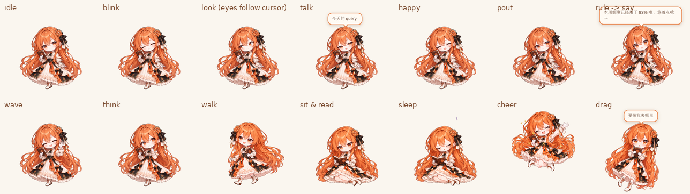

# MissClaude

拟人化的 Claude 桌宠：橙发、抱着书的 Q 版少女，住在 Windows 桌面的任务栏上面。会自己溜达、坐下看书、打瞌睡，
能被拎起来甩着玩，会对点击和摸头做出反应。她也是一个**有输入输出接口的模块**，可以接 Claude 用量、Claude Code hook
或者任何你想让她播报的数据，见 [docs/API.md](docs/API.md)。



更多效果：[动作库](docs/actions_showcase.webp) · [工作模式](docs/work_showcase.webp) · [眼神与口型](docs/eyes_showcase.webp) ·
[骨骼细节](docs/rig_v3_showcase.webp) · [观感打磨](docs/polish_showcase.webp)

## 运行

**直接用**：到 [Releases](https://github.com/AiChaosN/MissClaude/releases) 下载 `MissClaude-win32-x64-v*.zip`，解压后运行
`MissClaude.exe`（Windows 10/11 x64，自带运行时，不用装别的；exe 没有签名，SmartScreen 弹窗时选"仍要运行"）。

**从源码部署**（WSL 里执行）：

```bash
tools/deploy_windows.sh --shortcut
```

脚本会下载 Electron 44.9.3 的 win32 运行时（校验 SHA256），把它连同 `app/` 一起装到
`%LOCALAPPDATA%\MissClaude`，并在开始菜单里加一个 **MissClaude**。Windows 这边不需要另外安装任何东西。
之后改了代码，再跑一次 `tools/deploy_windows.sh` 就是更新：如果她正在运行，脚本只同步文件，然后调用
`POST /v1/admin/restart` 让她在原来的桌面会话里自己重启。菜单里的「重启（加载更新）」作用相同。

> 如果 WSL 是被某个服务启动的（这台机器上 Claude Code 就是这种情况），它运行在 Windows 的 Session 0 里，
> 从这里启动的程序没有桌面，桌宠会在后台"隐身"运行。脚本检测到这种情况会跳过自动启动，这时从开始菜单打开就行。

## 把她当成一个模块

她的设计目标是接进别的产品：产品只负责**输入数据、听她的事件**，怎么演由她自己（和你写的规则）决定。
完整接口见 [docs/API.md](docs/API.md)，一句话版本：

```
产品 ──signal──►  规则（rules.json）  ──►  指令：say / act / expression / perform  ──►  渲染
产品 ◄─events──  点击、摸头、拖拽、状态切换、说话、规则触发、表演开始/结束（SSE / webhook / 轮询）
```

| 要接的东西 | 怎么接 | 需要改程序吗 |
|---|---|---|
| 用量到头、额度刷新、构建失败这类**数据** | `POST /v1/signal`，写几条规则（条件 → 台词 / 动作 / 一段表演） | 不用 |
| **起床闹铃**、整点提醒、到点下班 | 她每分钟自己推 `clock` 信号，闹铃就是一条规则 | 不用 |
| 一个**全新的表演**（举手 → 喊话 → 加油） | `POST /v1/perform` 或规则里的 `steps`，用已有的动作、表情、台词按时间轴编排 | 不用 |
| 新的**台词池** | 规则的 `say` 写成列表，随机挑一句 | 不用 |
| 产品对她的**反应**（点她贪睡、摸头确认） | 订阅 `click` / `pet` / `drop` 等事件 | 不用 |
| 一个**新的基础动作**（新的手臂姿势、新表情） | 让 GPT 画一张对齐的改图 → `tools/build_rig.py` 的 `ARM_VARIANTS` / `build_assets.py` 的脸部表 → `actions.js` 加一条时间轴 | 要改，约 15 分钟一个 |
| **换角色** | 加一个角色包 `app/characters/<name>/`（素材、骨骼 poser、动作库、台词、自己的状态），引擎不用动；见 `app/characters/README.md` | 要画新素材，程序只加包 |

扩展点和限制：
- 接口有版本号（`/v1`）和自描述的 `/v1/capabilities`（动作、表情、事件、规则运算符、信号、上限），产品可以先查再用。
- 核心 `app/core/controller.js` 不依赖 HTTP，想嵌进别的 Node/Electron 进程可以直接调用它的方法、订阅事件。
- 规则改完保存即生效，也能通过接口整体替换；`cooldown` 和边沿触发（`crosses_above` 等）避免同一个状态反复触发。
- 现在只能有一个实例、只在本机监听；多台机器或多人共用需要在前面再加一层。
- 台词的语气、她自己的碎碎念、动作库本身都在角色包里（`app/characters/claude/lines.js`、`actions.js`），产品改不了；产品能做的是用自己的话让她说。

## 怎么和她玩

| 操作 | 反应 |
|---|---|
| 单击 | 开心 + 小跳 + 花瓣，偶尔会跳起来欢呼 |
| 双击 | 挥手打招呼 |
| 快速连点 5 次 | 鼓脸："别戳啦！" |
| 在头上来回摸 | 冒爱心："嘿嘿，好舒服～" |
| 拖起来 | 像钟摆一样晃，甩出去会抛飞，落地会挤压回弹 |
| 鼠标靠近 | 眼睛跟着看 |
| 右键她 / 右键托盘图标 | 菜单：打招呼、坐下看书、睡觉、到处走走、安静模式、大小、总在最前、开机自启动… |

只有她身上不透明的地方才接收鼠标，窗口其余部分会把点击透传给下面的程序。

## 动作库：连贯的表演

除了待机时的呼吸、眨眼、看鼠标，她还有 21 个带时间轴的连贯动作（`app/characters/claude/actions.js`）：每个动作把手臂姿势、
表情、头身动作（歪头、点头、后仰、跳、落地挤压）、眼神、台词和特效（💢 青筋、汗滴、?、!、音符、蒸汽、灯泡、阴影线、
星星、花瓣）编排在一条时间轴上，骨骼负责平滑过渡。

生气（叉腰跺脚→扭头撅嘴）、尴尬（挠脸冒汗）、坏笑（捂嘴偷笑→wink）、害羞（举书挡脸偷看）、委屈（抱书泪汪汪）、
灵光一闪、加油、举手、伸懒腰+打哈欠、指给你看、偷笑、wink、跳舞、得意、吓一跳、无聊、疑惑、打喷嚏、东张西望、
偷看书、哼歌。完整列表见 [docs/API.md](docs/API.md)。

她空闲时会按权重自己挑动作做；交互也会触发：连戳 5 下会生气，摸头有时会害羞，单击有时偷笑 / wink / 吓一跳 / 疑惑，
双击会挥手或举手，被狠狠甩到地上会尴尬或生气。坐着看书时会时不时翻一页。

为这些动作新画的素材：空着的手 7 种姿势（下垂、挥手、托腮、举高、捂嘴、叉腰、指、握拳、挠脸），拿书的手 3 种
（夹着书叉腰、抱书、举书挡脸），表情 6 个（wink、脸红、生气、坏笑、尴尬、泪汪汪），都是在去掉手臂的原图上让 GPT 重画的，
和原图逐像素对齐，直接作为骨骼的手臂变体。

## 工作模式

`act: work`（或 Claude Code 开始干活时）她会：往旁边轻轻一跳让出位置 → 书桌中间亮起一道竖直的光线 → 光线分成两道光边
向两边展开，书桌和凳子在两道光边之间淡入 → 她跳上凳子坐好 → 拿羽毛笔写字（前臂绕手肘小幅划动、手腕快速抖动、
头跟着字点、眼睛盯着纸、两只脚晃来晃去），时不时托腮思考（换成托腮的手、眼珠往右上方看），鼠标凑近时会瞟你一眼，
写完一段开心一下 → 结束时跳下凳子，两道光边
从桌椅两端向中间合拢，桌椅随之淡出，最后光线收成一点消失，她走回原位。

工作场景是第五套骨骼（16 层、23 根骨骼）：凳子和书桌是道具，可以脱离她单独显示；"完整的书桌"层只在桌椅单独出现时
显示，坐着时用"挡在她身前的部分"那一层（桌面、前腿），这样桌子藏在她身后的腿不会跑到她前面来。桌椅只在两道光边
之间可见（WebGL 用 scissor，2D 兜底用 clip），光线画在桌椅之上、她之下，所以光边扫过她时是从她身后经过。

## 观感细节

- **接触阴影**：脚下有一片暖棕色的柔和阴影，跳起来时缩小变淡，坐下时随铺开的裙子和头发变宽，工作时罩住桌椅；
  被拎起来时没有影子（地面不在窗口里）。
- **姿势之间的溶解**：站 ↔ 走 ↔ 坐 ↔ 工作这类整体换姿势的切换，用 0.1 秒的溶解过渡，不再是硬切。
- **气泡**跟着她的头走：让位、跳跃、被拎着晃的时候都在头顶上；消失时淡出下沉，出现时弹出。纸面带一点渐变和内高光，
  尾巴是一条向她头顶弯下去的圆弧形小尖（SVG，顶部盖住气泡边框，接缝看不出来）。
- **眼珠图层**带着自己的深色边缘一起切出来，所以边缘的羽化是白对白，眼珠周围没有亮环。
- **粒子**：花瓣是一头圆一头尖的真正花瓣形并带高光，小花有金色花心，闪光带辉光，爱心有反光点，扬尘是柔和的渐变。

## 分层骨骼（站姿）

她待得最久的站姿不是一张图，而是 15 个图层、24 根骨骼搭成的 2D 骨骼，做法和 Live2D、Spine 一样：

| 图层（从后到前） | 绑定 | 动起来是什么样 |
|---|---|---|
| hair_back 长发 | 顶部跟头，中段跟胸，外侧下段挂在 hairL/hairR 弹簧上 | 呼吸、歪头时跟着动，被风吹、跳起来会甩；离身体越远甩得越开 |
| body 身体 | 腰以上跟 chest（呼吸），下摆挂 skirt 弹簧 | 呼吸起伏，裙摆轻摆 |
| arm_down 垂下的手 | 肩 → 肘 → 腕 三节 | 手臂和手腕各自轻轻晃 |
| tassel_0..2 裙子和腰间的流苏 | 各自一根弹簧 | 跳起来、走路时晃荡 |
| head 头（含右肩前那缕侧发） | 绕脖子转；侧发下段滞后 | 歪头、点头、看鼠标时偏头 |
| iris_l / iris_r 眼珠 | eyeL/eyeR 只平移，被眼眶遮罩裁剪 | 连续地跟着鼠标转；没东西看时会自己乱瞟 |
| 表情补丁 | 跟头部骨骼 | 眨眼、开心、惊讶、鼓脸；说话时按字切换 a/i/u/e/o 五种口型 |
| bangs 刘海 | 挂在头顶的弹簧 | 跳、点头时轻轻弹一下 |
| earring 耳坠、ribbon 丝带 | 挂在头上的弹簧 | 歪头、跳动时晃荡 |
| arm_book 拿书的手 | 肩 | 偷看书时把书举起来 |
| arm_wave / arm_chin | 肘 → 腕 | 挥手时前臂摆、手腕甩；思考时食指点下巴 |

行为层只设置参数（headTilt、lean、bookLift、wave、tap……），由骨骼平滑过渡，再叠上呼吸和随机的小动作。
弹簧骨骼由转轴在屏幕上的加速度驱动：横向加速度让它摆，纵向加速度让它拉长，匀速移动时向后拖。

## 分层骨骼（走路）

走路姿势（3/4 侧身）是第二套骨骼：后发、两条腿、身体、摆动的手、头、两只耳坠、丝带。

- **腿**画在裙子后面，挂在静止的 root 上（髋关节藏在裙子里，下面还有脚踝）。原画里两条腿是迈步中的样子
  （前腿前伸 33°、后腿后摆 27°），骨骼用静止角先把两条腿都"扶正"，再让它们绕同样的弧线各摆 ±26°，相差半个周期，
  所以两条腿会**前后交叉换位**，而不是各自原地抖动。往前迈的那只脚抬起、脚尖上翘，蹬地时脚尖朝下。
- 步长是身高的 0.14 倍，和走路速度匹配，踩地的脚不会在地上打滑。
- **身体**在双脚交错时最高，左右轻摆、略微前倾；**手**和前腿反向摆；**头**慢半拍；长发、丝带、耳坠随步伐甩动并向后拖；
  走路时也会眨眼。

## 分层骨骼（坐、睡、被拎起）

- **坐着看书**：头随着读一行字从左往右微微转，眼珠也沿着那一行扫过去，换行时点一下头；鼠标靠近时会从书上抬眼看你；
  胸口呼吸起伏；铺在地上的长发几乎不动，丝带和耳坠轻晃。坐姿和工作姿势现在也有独立的眼珠和刘海图层。
- **睡着**：呼吸变深变慢，头慢慢往一侧垂下去，过一会儿猛地抬起来，接着又慢慢垂下。
- **被拎起来**：两条腿像蹬自行车一样交替乱蹬（髋 + 脚踝），身体扭动，头轻轻摇；整个人像钟摆一样晃，长发、裙摆、丝带都会甩起来。

只剩"跳起来欢呼"还是整图（带 shader 头发飘动）。

拆层所需的遮罩和被遮住的内容都来自"和原画逐像素对齐的改图"。站姿另有 `rm_bangs`（去掉刘海，露出额头和完整的眼睛）、
`eyes_blank`（在它上面把眼珠去掉，只剩眼白：眼白区域就是裁剪眼珠用的眼眶遮罩）、`seg_tassels`（流苏涂成纯青色）、
`rm_tassels`、`mouth_a/i/u/e/o`。走路、坐、被拎起各有一套 `<姿势>_seg_hair`、`<姿势>_rm_dangles`，
有腿的姿势还有把腿涂成纯蓝的 `<姿势>_seg_legs` 和 `<姿势>_rm_legs`。站姿的这些改图：`rm_arm_free` / `rm_arm_book`（去掉手臂，露出后面的衣服和头发）、
`rm_dangles`（去掉丝带和耳坠）、`seg_hair`（把头发涂成纯品红，比较后就得到头发遮罩）、`armf_wave` / `armf_chin`
（在去掉手臂的图上重新画的手臂，比较后差异就只有手臂本身）。`tools/build_rig.py` 负责切层、补洞，并校验静止时
叠回去和原画一致（静止时平均误差：站 1.6/255、走 1.5、坐 0.2、拎 1.5），`tools/export_assets.py` 生成
`app/characters/claude/assets/rig_{stand,walk,sit,drag,work}.json`。

## 素材管线

给的原画只有两张：`art/source/chibi_ref.png`（Q 版）和 `fullbody_ref.png`（立绘，只作设定参考）。
其余素材都是用 Codex CLI 内置的 `image_gen`（gpt-image）**以原画为基础做编辑**生成的。编辑结果和原图几乎逐像素对齐
（实测平移不到 0.3px），所以表情可以做成只覆盖脸部的补丁，直接叠回原画上。

```
art/source ──► tools/prompts.py ──► art/prompts/*.txt
                                         │ tools/codex_imagegen.py（codex exec + 内置 image_gen）
                                         ▼
                                     art/gen/*.png (+ .json：提示词、参考图、thread id)
                                         │ tools/build_assets.py
                                         ▼
                                     art/work/  抠图、表情补丁、手臂帧
                                         │ tools/export_assets.py
                                         ▼
                                     app/characters/claude/assets/  缩放 + 头部归一化 + 锚点 + 头发飘动权重图 + manifest.json
```

几个关键做法：

- **底图保留原画像素**：alpha 用 triangulation matting 求。同一张图在白底（原画）和绿底（编辑结果）上各有一份，
  两者相减就能解出 alpha，跟前景是什么颜色无关；颜色再从白底里反解出来，原画本身一点不动。
- **新姿势**用绿幕生成，本地抠图。橙发边缘和发丝缝隙里带阴影的暗绿，用局部前景/背景色投影重新求 alpha，避免出现橄榄色毛边。
- **表情补丁**：把编辑图和原图逐像素比较，取有差异的区域，羽化后裁出来。眼睛层（眨眼、半闭、左看、右看）和
  嘴巴层（说话）可以叠加；整脸层（开心、惊讶、鼓脸）会替换整张脸。
- **挥手**：两帧都只替换手臂区域，其余部分是同一份像素，来回切换不会闪。
- **大小归一化**：多尺度模板匹配头部，保证每个姿势的头一样大；walk 是 3/4 侧脸，会被误判偏小，所以手动指定。

| 姿势 | 表情（叠加） | 生成方式 |
|---|---|---|
| idle（站） | 眨眼、半闭、左看、右看、说话、开心、惊讶、鼓脸 | 原画 + 补丁 |
| wave_a / wave_b（挥手两帧） | 共用 idle 的补丁 | 只编辑手臂 |
| think（托腮） | 自带向上看 | 编辑手臂 + 眼睛 |
| walk（3/4 侧身迈步，向左时镜像） | 自带 | 新姿势 |
| cheer（跳起欢呼） | 自带 | 新姿势 |
| drag（被拎起，也用作下落） | 自带惊讶 | 新姿势 |
| sit_read（坐着看书） | 眨眼、睡着 | 新姿势 + 补丁 |

重新生成或者新增素材：在 `tools/prompts.py` 里写提示词，然后

```bash
python3 tools/prompts.py
python3 tools/codex_imagegen.py art/gen/NAME.png art/prompts/NAME.txt -i art/source/chibi_ref.png
python3 tools/build_assets.py && python3 tools/export_assets.py
```

## 仓库里有什么、没有什么

```
app/        可直接运行的应用（含 app/characters/claude/assets：已导出的精灵、骨骼、表情贴图，约 11 MB）
art/source  两张原画
art/gen     让 GPT 生成的全部改图，每张配一个 .json 记录提示词和参考图（骨骼的真正素材源，约 170 MB）
art/prompts 生成用的提示词（tools/prompts.py 生成）
art/work    中间产物（抠图、分层、补丁），不入库：从 art/source + art/gen 可确定性重建
docs/       接口文档和效果动图
```

重建中间产物并重新导出（约 4 分钟）：

```bash
npm run assets      # = build_assets.py && build_rig.py && export_assets.py
```

## 代码结构

```
app/                      Electron 应用（部署时整个目录被同步到 Windows）
  main.js                 透明置顶窗口、托盘和菜单、app:// 协议、启动 API；按设置加载一个角色包
  core/controller.js      模块核心：输入 → 渲染指令，交互 → 输出事件（不依赖传输方式）
  core/server.js          HTTP/SSE 适配层（127.0.0.1:27826）
  core/rules.js           信号规则引擎（条件、模板、台词列表、steps 表演）
  core/default-rules.json 默认规则（Claude 用量提醒）
  engine/pet.js           与角色无关的部分：窗口几何、状态机、走/拎/摔/落地/表演、说话、口型、鼠标、渲染
  engine/rig.js           分层骨骼：蒙皮网格、骨骼层级、弹簧物理、参数缓动（poser 来自角色包）
  engine/gl.js            WebGL2 渲染（整图 shader 飘发 + 网格）+ Canvas2D 兜底
  engine/fx.js            粒子：花瓣、五瓣花、闪光、爱心、Zzz
  engine/anim.js          缓动等小工具
  characters/claude/      Claude 的角色包（见 app/characters/README.md）
    character.json        窗口比例、尺寸、菜单、动作/表情列表
    behaviour.js          她自己的状态：看书、打盹、思考、挥手、欢呼、书桌工作，以及各种反应
    posers.js             五种骨骼的 poser、头发/裙子/头的蒙皮方式
    actions.js            动作库：21 个带时间轴的连贯表演
    lines.js              台词
    assets/               已导出的精灵、骨骼、表情贴图
clients/python/           Python 客户端 + 命令行
integrations/claude-code/ Claude Code hook 脚本
examples/usage_demo.py    模拟用量曲线，演示规则触发
examples/alarm_demo.py    闹铃：一条 clock 规则 + 一段表演，点她可以贪睡
tools/                    素材管线（build_assets / build_rig / export_assets）、预览、录制、Windows 部署、release 打包
tests/                    node --test（核心/HTTP）+ Playwright 交互测试
```

## 测试

```bash
npm test                                 # 下面两项一起
node --test tests/                       # 规则引擎、controller、HTTP/SSE、clock、perform
python3 tests/interaction_test.py        # 用模拟鼠标测：点击、双击、连戳、拖拽和下落、摸头
python3 tools/preview.py /tmp/pet        # headless 渲染每个状态的截图（--renderer 2d 测兜底渲染）
python3 tools/record.py /tmp/rec showcase3 --seconds 26  # 逐帧确定性录制成 WebP 动图（act:<动作名>、work、eyes…）
```

## 运行时文件

`%APPDATA%\MissClaude\` 下：`settings.json`（只保存改过的设置项）、`rules.json`（规则，改完自动生效）、
`main.log`（主进程和渲染进程的报错）。

## 渲染兜底

有 WebGL2 时用 GPU 渲染：骨骼图层是蒙皮网格，头发和饰品有物理。如果拿不到 WebGL，或者 GPU 进程崩溃后
1.5 秒内没恢复（Session 0、部分远程桌面、驱动出问题），会自动切到 Canvas2D：骨骼图层退化成跟随各自主骨骼的刚体，
头发不再弯曲飘动，其余动作照常。
`ready` 事件里的 `renderer` 字段会告诉你当前用的是哪个。
